# Manual de Autenticación y Seguridad — School Schedule

Documento técnico de las funcionalidades de autenticación y seguridad del sistema
**School Schedule** (backend Spring Boot 3.3.5 / Java 21, frontend Angular 17).

Cubre tres bloques implementados y verificados:

1. Login facial (verificación 1:1 con descriptores).
2. Bloqueo de cuenta por intentos fallidos.
3. RF-01: política de contraseñas, expiración y cambio con código (OTP) por correo.

> Los diagramas están en formato Mermaid. Se visualizan en GitHub, VS Code (extensión
> *Markdown Preview Mermaid*) o al convertir este archivo a Word/PDF (ver
> [Conversión a DOCX](#13-conversión-a-docx)).

---

## Índice

1. [Arquitectura general](#1-arquitectura-general)
2. [Modelo de datos](#2-modelo-de-datos)
3. [Login con usuario y contraseña](#3-login-con-usuario-y-contraseña)
4. [Login facial](#4-login-facial)
5. [Bloqueo de cuenta por intentos fallidos](#5-bloqueo-de-cuenta-por-intentos-fallidos)
6. [RF-01: políticas de contraseña](#6-rf-01-políticas-de-contraseña)
7. [Cambio de contraseña con código (OTP)](#7-cambio-de-contraseña-con-código-otp)
8. [Correo obligatorio en el mantenedor de profesores](#8-correo-obligatorio-en-el-mantenedor-de-profesores)
9. [Catálogo de endpoints](#9-catálogo-de-endpoints)
10. [Catálogo de servicios](#10-catálogo-de-servicios)
11. [Mensajes de interfaz](#11-mensajes-de-interfaz)
12. [Despliegue en producción](#12-despliegue-en-producción)
13. [Conversión a DOCX](#13-conversión-a-docx)
14. [Anexo: proyecto login-system](#14-anexo-proyecto-login-system)
15. [Módulo académico: notas, trimestres y promoción](#15-módulo-académico-notas-trimestres-y-promoción)

---

## 1. Arquitectura general

El sistema tiene tres piezas: un frontend Angular, un backend Spring Boot y una base de
datos PostgreSQL. El backend expone una API REST protegida con JWT.

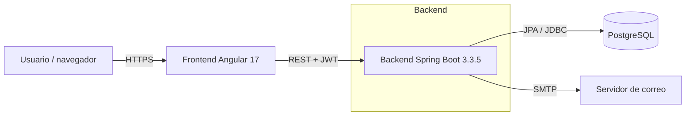

**Puertos por defecto**

| Componente | Puerto desarrollo | Puerto contenedor |
|---|---|---|
| Frontend (Angular / Nginx) | 4201 | 80 |
| Backend (Spring Boot) | 8081 | 8081 |
| PostgreSQL | 5432 | 5432 |

**Autenticación.** Todas las rutas bajo `/api/**` requieren un JWT válido en la cabecera
`Authorization: Bearer <token>`. Las rutas públicas son las de login y las del flujo de
cambio de contraseña. El token lo emite `JwtService` y lo valida `JwtAuthFilter` en cada
petición.

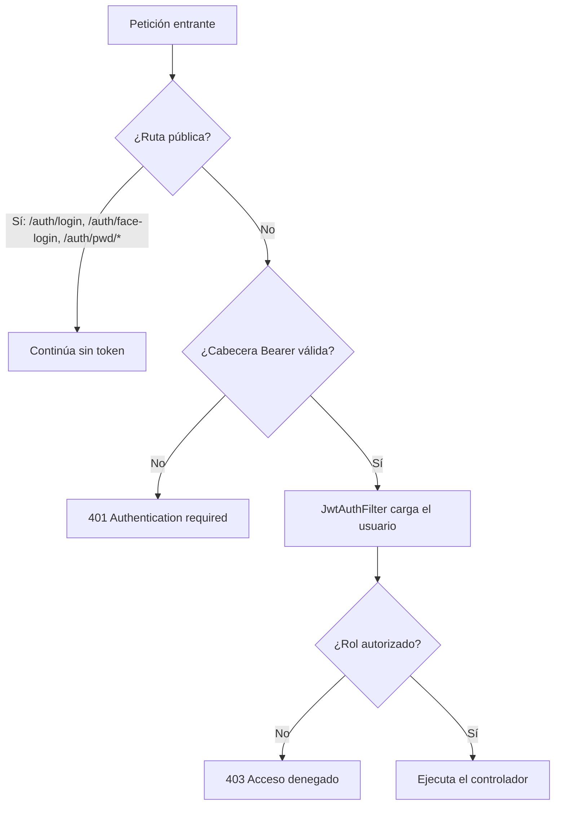

---

## 2. Modelo de datos

### 2.0 Diagrama entidad-relación

Modelo de datos completo de `school-schedule`. `ddl-auto=update` crea y actualiza el esquema
automáticamente; ninguna columna requiere migración manual.

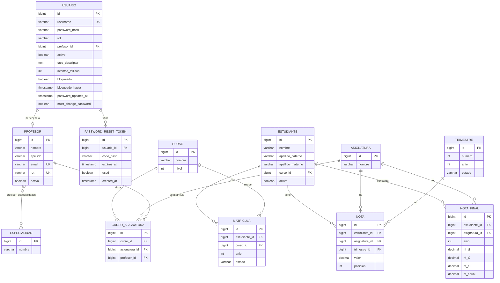

**Claves e índices únicos**

| Tabla | Unicidad |
|---|---|
| `usuario` | `username` |
| `profesor` | `email`, `rut` |
| `matriculas` | (`estudiante_id`, `anio`) |
| `notas` | (`estudiante_id`, `asignatura_id`, `trimestre_id`, `posicion`) |
| `nota_final` | (`estudiante_id`, `asignatura_id`, `anio`) |
| `trimestres` | (`numero`, `anio`) |

> La tabla `password_reset_token` y las columnas de seguridad de `usuario` se detallan a
> continuación; el resto del modelo académico se explica en la
> [sección 15](#15-módulo-académico-notas-trimestres-y-promoción).

### 2.1 Columnas de seguridad

Columnas relevantes para seguridad. `ddl-auto=update` crea las columnas nuevas
automáticamente; ninguna requiere migración manual.

### Entidad `Usuario` (tabla `usuario`)

| Campo | Tipo | Descripción |
|---|---|---|
| `id` | bigint (PK) | Identificador |
| `username` | varchar(50), único | Usuario de login (RUT para docentes, `admin` para el administrador) |
| `password_hash` | varchar(255) | Hash BCrypt de la contraseña |
| `rol` | varchar(20) | `ADMIN` o `DOCENTE` |
| `profesor_id` | FK → profesores | Profesor asociado (null para admin) |
| `activo` | boolean | Cuenta habilitada |
| `face_descriptor` | text | Descriptor facial (128 valores) en JSON. Null si no hay rostro |
| `intentos_fallidos` | int (def. 0) | Fallos de login consecutivos (contraseña + rostro) |
| `bloqueado` | boolean (def. false) | Bloqueo permanente |
| `bloqueado_hasta` | timestamp | Fin del bloqueo temporal (admin) |
| `password_updated_at` | timestamp | Fecha del último cambio de contraseña (vigencia) |
| `must_change_password` | boolean (def. false) | Fuerza el cambio en el próximo login |

### Entidad `PasswordResetToken` (tabla `password_reset_token`)

| Campo | Tipo | Descripción |
|---|---|---|
| `id` | bigint (PK) | Identificador |
| `usuario_id` | FK → usuario | Dueño del código |
| `code_hash` | varchar(255) | Hash BCrypt del código de 5 dígitos (nunca en claro) |
| `expires_at` | timestamp | Expiración del código (15 min) |
| `used` | boolean | Marca el código como consumido |
| `created_at` | timestamp | Fecha de generación |

### Entidad `Profesor` (tabla `profesores`)

| Campo | Tipo | Descripción |
|---|---|---|
| `email` | varchar(255), único | Correo. Obligatorio al crear/editar (RF-01.4) |

---

## 3. Login con usuario y contraseña

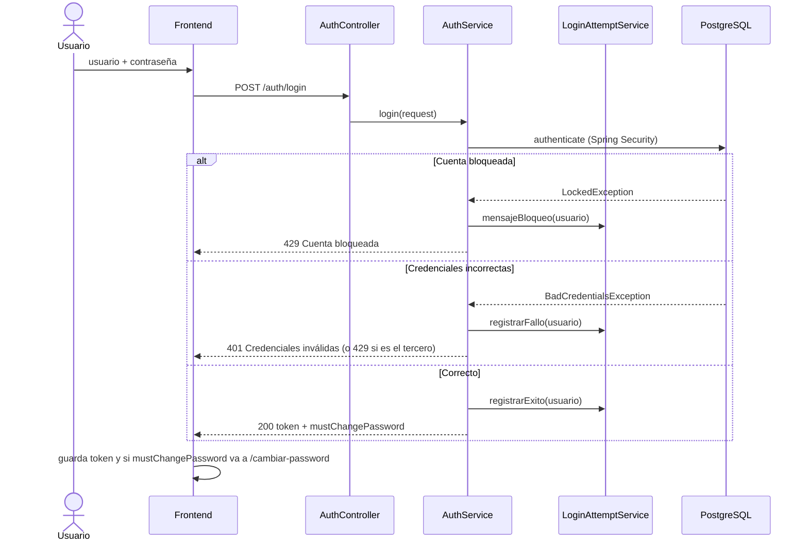

El token incluye el `rol` y, para docentes, el `profesorId`. La respuesta trae la bandera
`mustChangePassword`; si viene `true`, el frontend redirige al flujo de cambio.

---

## 4. Login facial

Verificación **1:1**: el usuario declara su identidad (usuario/RUT) y el sistema compara el
rostro capturado contra el descriptor que tiene registrado, no contra todos los usuarios.

### 4.1 Registro del rostro (enrolamiento)

Requiere sesión iniciada, confirmar la contraseña y aceptar el consentimiento del dato
biométrico. La cámara solo se activa cuando ambos están completos.

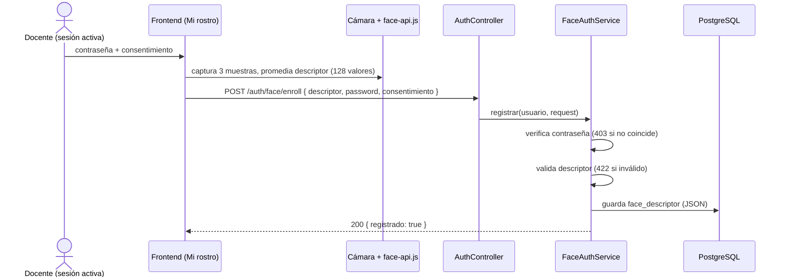

### 4.2 Login facial

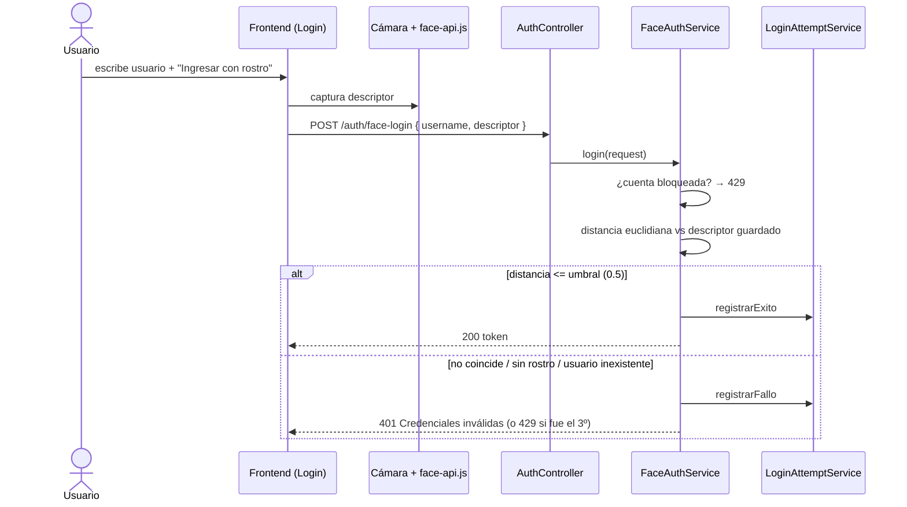

**Decisiones de diseño**

- **Umbral de distancia:** 0.5 por defecto (`schedule.face.threshold`). Menor = más estricto.
- **Captura robusta:** el frontend toma 3 muestras y promedia el descriptor.
- **Antienumeración:** usuario inexistente, sin rostro o rostro distinto devuelven el mismo
  error 401.
- **Carga diferida:** la librería `@vladmandic/face-api` (1.28 MB) se carga en un chunk
  aparte; no pesa en el bundle inicial.
- **Modelos:** `tiny_face_detector`, `face_landmark_68` y `face_recognition`, servidos en
  `/assets/models`.

**Limitación conocida:** no hay detección de vida (*liveness*). Una foto podría engañar al
reconocimiento. El login facial es una comodidad adicional; la contraseña sigue siendo el
método de respaldo.

---

## 5. Bloqueo de cuenta por intentos fallidos

Contraseña y rostro comparten un **único contador** de fallos. Al **tercer** fallo la cuenta
se bloquea. El bloqueo se persiste en la base de datos (sobrevive a reinicios).

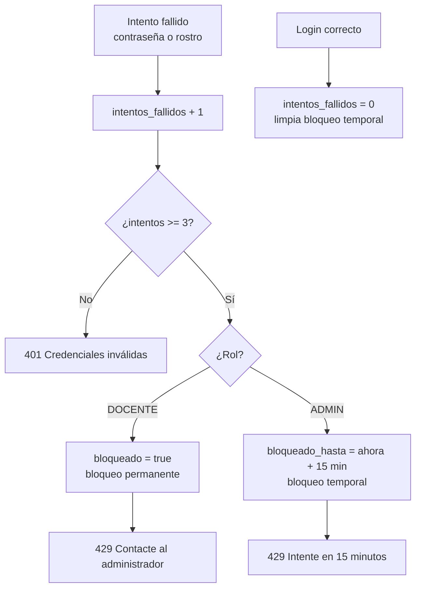

**Diferencia por rol**

- **DOCENTE:** bloqueo **permanente**. Solo un ADMIN lo quita desde *Usuarios bloqueados*.
- **ADMIN:** bloqueo **temporal de 15 minutos**, que vence solo. Evita dejar el sistema sin
  administrador.

### Desbloqueo (ADMIN)

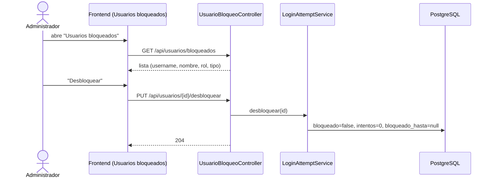

**Consideración de seguridad.** Como el usuario del docente es su RUT (dato conocido),
cualquiera podría bloquear una cuenta ajena escribiendo 3 contraseñas falsas. Es la
contrapartida aceptada del bloqueo permanente. La vía de recuperación es el desbloqueo por
un ADMIN.

---

## 6. RF-01: políticas de contraseña

Centralizadas en `PasswordPolicyService`. Aplican **solo al perfil DOCENTE**; el ADMIN está
exento (mantiene su propia directiva).

### 6.1 Complejidad (RF-01.1)

Contraseña de docente: mínimo 6 caracteres, al menos un número y al menos un carácter
especial.

```
Regex: ^(?=.*[0-9])(?=.*[!@#$%^&*()_+\-=\[\]{};':"\\|,.<>\/?]).{6,}$
```

Se valida en el frontend (feedback inmediato) y en el backend (fuente de verdad).

### 6.2 Vigencia y expiración (RF-01.2)

La contraseña del docente vence a los **6 meses** desde `password_updated_at`.

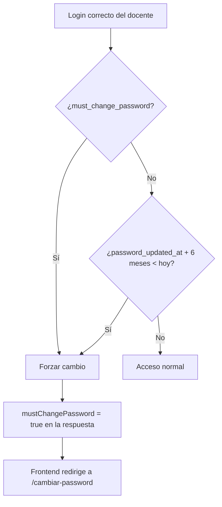

- Las cuentas existentes reciben `password_updated_at = ahora` en el arranque
  (`DataInitializer`), para que no venzan todas de golpe.
- Las claves sembradas (`1234`) no cumplen la regla nueva, pero siguen válidas: la regla
  solo se exige al **cambiarlas**.

---

## 7. Cambio de contraseña con código (OTP)

Flujo público de dos pasos (RF-01.3): pedir el código y confirmar el cambio. Corresponde al
diagrama del requerimiento.

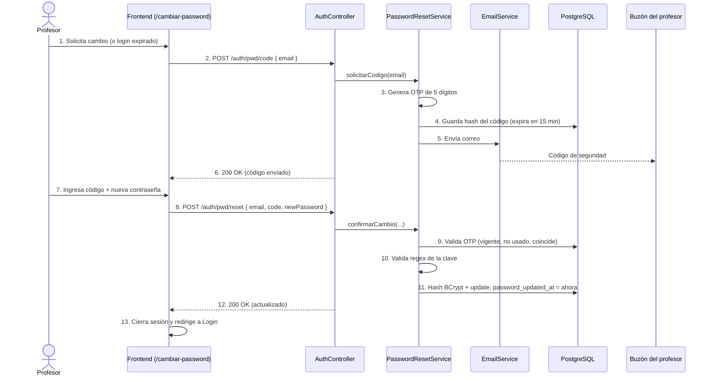

**Reglas del OTP**

- 5 dígitos, hash BCrypt en base de datos (nunca en claro).
- Vigencia de 15 minutos; un solo uso (`used`).
- Solicitar un código nuevo invalida los anteriores del usuario.
- Respuesta idéntica exista o no el correo (antienumeración).

**Envío del correo.** Lo maneja `EmailService`:

- Con SMTP configurado (variables `MAIL_*`), envía el correo real.
- Sin SMTP, el servicio queda deshabilitado y el código se escribe en el **log** del
  servidor, como respaldo para desarrollo.
- `schedule.otp.expose-code` permite devolver el código en la respuesta **solo en modo
  demo**. Debe estar en `false` en producción.

---

## 8. Correo obligatorio en el mantenedor de profesores

RF-01.4: al crear o editar un profesor, el correo es obligatorio, con formato válido y único.

```
Regex email: ^[a-zA-Z0-9._%+-]+@[a-zA-Z0-9.-]+\.[a-zA-Z]{2,}$
```

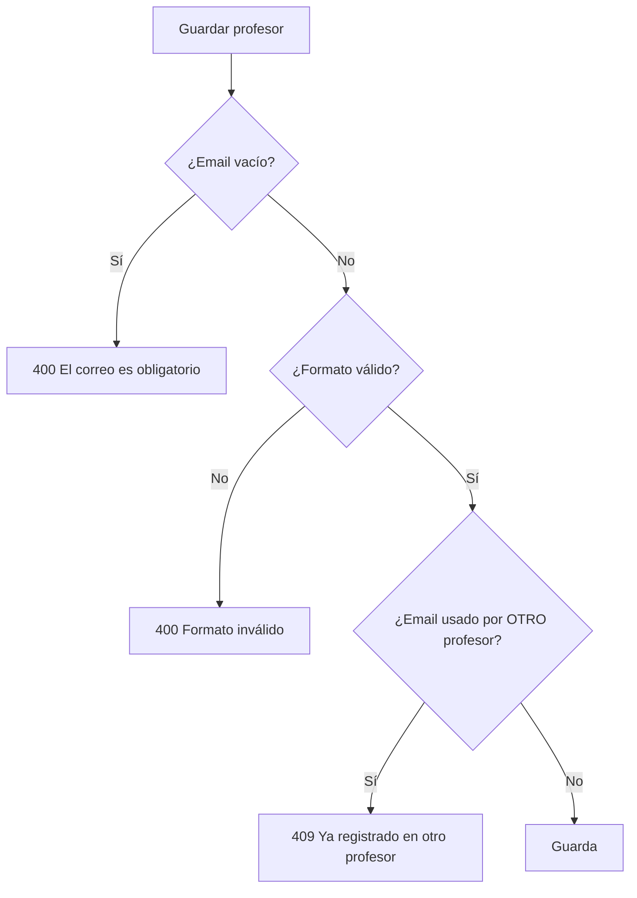

El formato se valida en frontend y backend. La unicidad la revisa `ProfesorService` antes de
guardar y devuelve un 409 claro, en vez del error crudo de la base de datos.

---

## 9. Catálogo de endpoints

| Método | Ruta | Acceso | Descripción |
|---|---|---|---|
| POST | `/auth/login` | Público | Login con usuario y contraseña |
| POST | `/auth/face-login` | Público | Login facial (usuario + descriptor) |
| POST | `/auth/pwd/code` | Público | Solicita código OTP al correo |
| POST | `/auth/pwd/reset` | Público | Valida código y cambia la contraseña |
| POST | `/auth/face/enroll` | Autenticado | Registra/reemplaza el rostro propio |
| GET | `/auth/face/status` | Autenticado | Indica si el usuario tiene rostro |
| DELETE | `/auth/face` | Autenticado | Elimina el rostro propio |
| GET | `/api/usuarios/bloqueados` | ADMIN | Lista usuarios bloqueados |
| PUT | `/api/usuarios/{id}/desbloquear` | ADMIN | Desbloquea un usuario |
| GET/POST/PUT/DELETE | `/api/profesores/**` | ADMIN | Mantenedor de profesores |

**Códigos de estado usados:** 200 OK, 204 Sin contenido, 400 Validación, 401 No autenticado
/ credenciales inválidas, 403 Acceso denegado / contraseña incorrecta al enrolar, 409
Duplicado, 422 Regla de negocio (OTP / política), 429 Cuenta bloqueada.

---

## 10. Catálogo de servicios

| Servicio | Responsabilidad |
|---|---|
| `AuthService` | Login con contraseña; emite el JWT y la respuesta de sesión |
| `FaceAuthService` | Enrolamiento, login facial, comparación por distancia euclidiana |
| `LoginAttemptService` | Contador de fallos y bloqueo (permanente/temporal); desbloqueo |
| `PasswordPolicyService` | Reglas de complejidad y expiración (solo DOCENTE) |
| `PasswordResetService` | Generación y validación del OTP; cambio de contraseña |
| `EmailService` | Envío SMTP con respaldo a log si no hay correo configurado |
| `JwtService` | Firma y validación de tokens JWT |
| `ProfesorService` | Mantenedor de profesores; valida correo único |

---

## 11. Mensajes de interfaz

| Situación | Mensaje |
|---|---|
| Contraseña débil (docente) | La contraseña debe tener al menos 6 caracteres, incluir al menos un número y un carácter especial. |
| Contraseña expirada | Su contraseña ha caducado por motivos de seguridad (vigencia superada de 6 meses). Debe actualizarla para continuar. |
| Código incorrecto o expirado | El código de seguridad ingresado es inválido o ha expirado. Por favor, intente nuevamente. |
| Código reenviado | Hemos enviado un nuevo código de 5 dígitos a su correo electrónico. |
| Email vacío (mantenedor) | El correo electrónico es obligatorio. |
| Email con formato erróneo | Por favor, ingrese un formato de correo electrónico válido (ejemplo: usuario@dominio.cl). |
| Cuenta bloqueada (docente) | Cuenta bloqueada por 3 intentos fallidos. Contacte al administrador. |
| Cuenta bloqueada (admin) | Cuenta bloqueada temporalmente por 3 intentos fallidos. Intente nuevamente en 15 minutos. |

---

## 12. Despliegue en producción

### 12.1 Variables de entorno

Nunca se guardan credenciales en el repositorio. El backend las lee del entorno.

| Variable | Descripción | Ejemplo |
|---|---|---|
| `DB_URL` | URL JDBC de PostgreSQL | `jdbc:postgresql://db:5432/scheduledb` |
| `DB_USERNAME` | Usuario de base de datos | `usuariolocal` |
| `DB_PASSWORD` / `SPRING_DATASOURCE_PASSWORD` | Contraseña de base de datos | *(secreto)* |
| `JWT_SECRET` | Clave de firma JWT, Base64 de 256 bits | *(secreto)* |
| `CORS_ALLOWED_ORIGINS` | Orígenes permitidos | `https://app.midominio.cl` |
| `MAIL_HOST` | Servidor SMTP | `smtp.gmail.com` |
| `MAIL_PORT` | Puerto SMTP | `587` |
| `MAIL_USERNAME` | Cuenta de envío | `no-reply@midominio.cl` |
| `MAIL_PASSWORD` | Contraseña/app password SMTP | *(secreto)* |
| `MAIL_FROM` | Remitente (por defecto, `MAIL_USERNAME`) | `no-reply@midominio.cl` |
| `OTP_EXPOSE_CODE` | Exponer el código en la respuesta | **`false` en producción** |
| `SCHEDULE_FACE_THRESHOLD` | Umbral de distancia facial | `0.5` |

### 12.2 Checklist de endurecimiento

- [ ] `OTP_EXPOSE_CODE=false`. El código solo debe viajar por correo.
- [ ] `JWT_SECRET` propio, de al menos 256 bits, fuera del repo.
- [ ] `CORS_ALLOWED_ORIGINS` restringido al dominio real del frontend.
- [ ] **HTTPS obligatorio.** La cámara (getUserMedia) solo funciona en contexto seguro, y
      el JWT no debe viajar en claro.
- [ ] Credenciales SMTP y de base de datos en un gestor de secretos, no en texto plano.
- [ ] Copias de seguridad de PostgreSQL (incluye rostros y bloqueos).
- [ ] Revisar `ddl-auto`: `update` es cómodo, pero en producción estricta conviene migrar
      con una herramienta de versionado de esquema y dejar `validate`.

### 12.3 Despliegue con Docker Compose

El repositorio incluye `docker-compose.yml` con tres servicios: `db`, `backend` y
`frontend`. El frontend se sirve con Nginx.

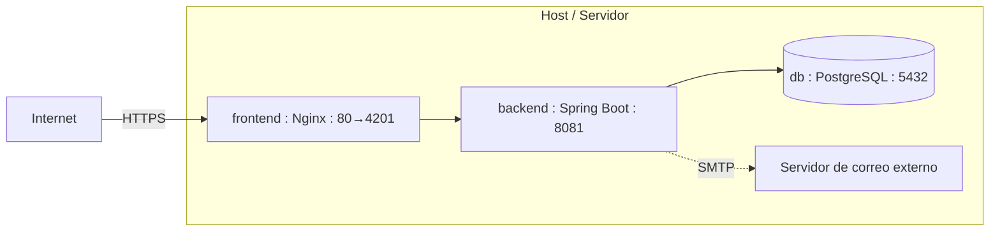

Pasos:

1. Crear un archivo `.env` (a partir de `.env.example`) con `DB_USERNAME` y `DB_PASSWORD`.
   Añadir las variables `MAIL_*`, `JWT_SECRET` y `OTP_EXPOSE_CODE=false`.
2. `docker compose build`
3. `docker compose up -d`
4. Verificar: `docker compose ps` y los logs de `backend`.

En producción conviene poner un proxy inverso con TLS (por ejemplo, Nginx o Traefik) delante
del frontend, y no exponer el puerto 5432 fuera de la red interna.

### 12.4 Consideraciones operativas

- **Reinicio del backend:** si se ejecuta fuera de Compose, exportar antes
  `SPRING_DATASOURCE_PASSWORD` y las variables `MAIL_*`; de lo contrario el envío de correo
  cae a modo log y la conexión a base de datos falla.
- **Datos biométricos:** el `face_descriptor` es un dato personal sensible. Debe tratarse
  según la normativa aplicable, con consentimiento (ya exigido en el enrolamiento) y
  posibilidad de eliminación (endpoint `DELETE /auth/face`).
- **Sesiones activas:** un bloqueo no expulsa a quien ya tiene sesión; su JWT sigue válido
  hasta expirar. Para corte inmediato habría que añadir una lista de revocación.

---

## 13. Conversión a DOCX

Este manual está en Markdown con diagramas Mermaid. Para obtener un `.docx` de Word con los
diagramas renderizados, la vía recomendada es [Pandoc](https://pandoc.org) junto con un
filtro de Mermaid:

```bash
# 1. Instalar Pandoc y el filtro (requiere Node.js)
npm install -g mermaid-filter

# 2. Generar el documento Word
pandoc docs/MANUAL-AUTENTICACION.md -o MANUAL-AUTENTICACION.docx --filter mermaid-filter
```

Alternativas sin instalar nada:

- Abrir el `.md` en **VS Code** con la extensión *Markdown Preview Mermaid Support* y
  exportar a PDF.
- Pegar el contenido en un editor Markdown en línea que soporte Mermaid (por ejemplo, un
  repositorio de GitHub) y exportar.

> Nota: Word no interpreta Mermaid de forma nativa. Sin el filtro de Pandoc, los diagramas
> aparecerían como bloques de texto en lugar de imágenes.

---

## 14. Anexo: proyecto login-system

`login-system` es un **proyecto independiente** de `school-schedule`, con su propio backend
y frontend. Las secciones 1 a 13 describen `school-schedule`; este anexo documenta
`login-system` y sus diferencias.

### 14.1 Diferencias con school-schedule

| Aspecto | school-schedule | login-system |
|---|---|---|
| Spring Boot / Java | 3.3.5 / Java 21 | 3.2.5 / Java 17 |
| Backend (puerto) | 8081 | 8080 |
| Frontend (puerto) | 4201 | 4200 |
| Identidad de login | `username` (RUT / admin) | `email` |
| Entidad usuario | `Usuario` (id numérico) | `User` (id UUID) |
| Base de datos | `scheduledb` (persistente) | `authdb` (`ddl-auto=create-drop`) |
| Tokens | Un JWT de acceso | Access token + refresh token |
| Roles | `ADMIN`, `DOCENTE` | `USER`, `ADMIN` (enum `Role`) |
| Registro de usuarios | Sembrado por `DataInitializer` | Endpoint público `/auth/register` |

> **Importante:** `login-system` usa `ddl-auto=create-drop`. Cada reinicio del backend
> **borra** la base `authdb`, incluidos los usuarios y los rostros registrados. Es apto para
> desarrollo, no para producción; allí debe cambiarse a `validate` o `update` con migraciones.

### 14.2 Arquitectura y tokens

A diferencia de `school-schedule` (un solo JWT), `login-system` maneja dos tokens:

- **Access token** (JWT, vida corta, 15 min por defecto): autoriza las peticiones.
- **Refresh token** (persistido en la tabla `refresh_tokens`, 7 días): permite renovar el
  access token sin volver a autenticar. Se revoca en logout y al rotarse.

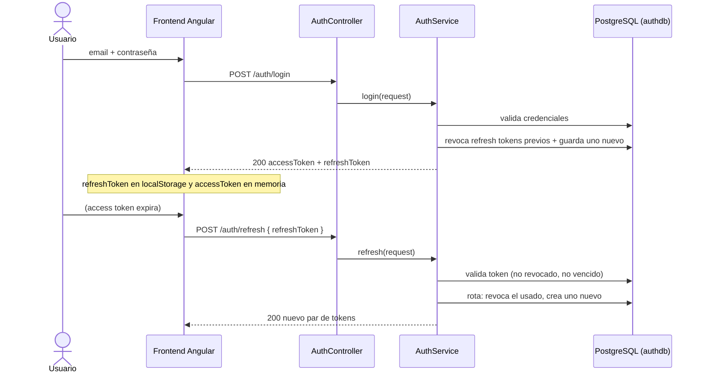

El interceptor del frontend detecta un 401, intenta `refresh` automáticamente y reintenta la
petición original; si el refresh falla, cierra la sesión.

### 14.3 Registro de usuario (RegisterRequest)

`login-system` permite el alta pública de usuarios con su propia política de contraseña
(distinta del RF-01 de `school-schedule`):

```
Regex: ^(?=.*[a-z])(?=.*[A-Z])(?=.*\d).+$   (mínimo 8, una minúscula, una mayúscula, un número)
```

### 14.4 Login facial en login-system

Se añadió el mismo mecanismo de reconocimiento facial que en `school-schedule` (verificación
1:1 por distancia euclidiana, umbral 0.5, 128 valores), adaptado al estilo del proyecto:

- La identidad es el **email**, no el usuario.
- Los DTO son `records` (`FaceLoginRequest`, `FaceEnrollRequest`).
- El login facial reutiliza `AuthService.issueSession(user)`, que emite el par
  access/refresh igual que el login normal.
- El limitador de intentos (`FaceAttemptLimiter`) es **en memoria**: bloqueo temporal de 5
  minutos tras 5 fallos. No se persiste (coherente con `create-drop`).
- `enroll` con contraseña incorrecta devuelve **403** (no 401), para que el interceptor no
  confunda el caso con un token vencido.

> El bloqueo persistente de 3 intentos y el flujo OTP del RF-01 son **exclusivos de
> school-schedule**. `login-system` conserva su limitador en memoria de 5 intentos.

### 14.5 Endpoints de login-system

| Método | Ruta | Acceso | Descripción |
|---|---|---|---|
| POST | `/auth/register` | Público | Alta de usuario |
| POST | `/auth/login` | Público | Login con email y contraseña |
| POST | `/auth/face-login` | Público | Login facial (email + descriptor) |
| POST | `/auth/refresh` | Público | Renueva el par de tokens |
| POST | `/auth/logout` | Autenticado | Revoca los refresh tokens del usuario |
| POST | `/auth/face/enroll` | Autenticado | Registra/reemplaza el rostro |
| GET | `/auth/face/status` | Autenticado | Indica si el usuario tiene rostro |
| DELETE | `/auth/face` | Autenticado | Elimina el rostro |
| GET | `/api/me` | Autenticado | Datos del usuario actual |
| GET | `/api/admin/users` | ADMIN | Lista de usuarios |

### 14.6 Modelo de datos (login-system)

**`User` (tabla `users`)** — `id` UUID, `full_name`, `email` (único), `password_hash`,
`role` (enum), `created_at`, `enabled`, y `face_descriptor` (text, añadido para el rostro).

**`RefreshToken` (tabla `refresh_tokens`)** — `id` UUID, `token` (único, 512), `user_id`
(FK), `expires_at`, `revoked`, `created_at`.

### 14.7 Variables de entorno (login-system)

| Variable | Descripción | Ejemplo |
|---|---|---|
| `DB_URL` | URL JDBC | `jdbc:postgresql://localhost:5432/authdb` |
| `DB_USERNAME` / `DB_PASSWORD` | Credenciales de base de datos | *(secreto)* |
| `JWT_SECRET` | Clave de firma, Base64 256 bits | *(secreto)* |

Para producción aplican las mismas recomendaciones de la sección 12: HTTPS obligatorio,
secretos fuera del repo, CORS restringido y cambiar `ddl-auto` de `create-drop` a un esquema
versionado para no perder datos en cada reinicio.

---

## 15. Módulo académico: notas, trimestres y promoción

Esta sección documenta el corazón funcional de `school-schedule`: cómo se ingresan las
notas, cómo se calculan las notas finales, el ciclo de vida de los trimestres y la promoción
de año.

### 15.1 Diagrama de clases del dominio

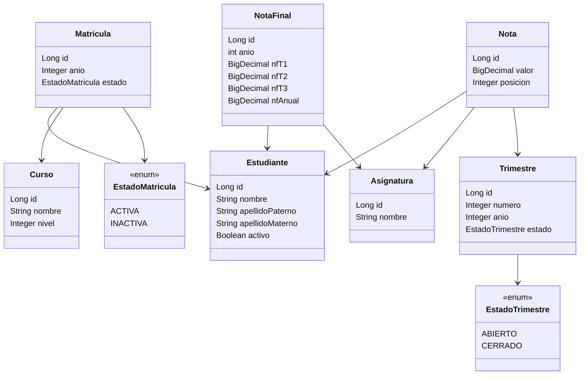

**Restricciones de unicidad**

- `Nota`: única por (estudiante, asignatura, trimestre, **posición**). Hasta 9 notas por
  trimestre (posiciones 1–9).
- `NotaFinal`: única por (estudiante, asignatura, **año**).
- `Matricula`: única por (estudiante, **año**).
- `Trimestre`: único por (número, año).

### 15.2 Ciclo de vida del trimestre

Regla central: en todo el sistema puede haber **a lo sumo un trimestre ABIERTO** a la vez
(en cualquier año). Al abrir uno, los demás se cierran automáticamente.

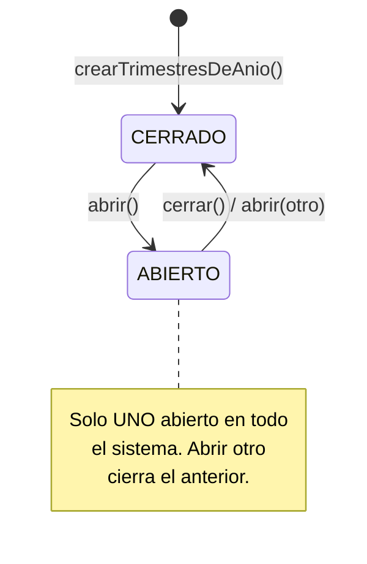

- Los tres trimestres de un año se crean juntos en estado **CERRADO**.
- Solo con el trimestre **ABIERTO** se pueden ingresar o modificar notas; con el trimestre
  **CERRADO**, cualquier intento de grabar o borrar devuelve 409.

### 15.3 Ingreso de notas

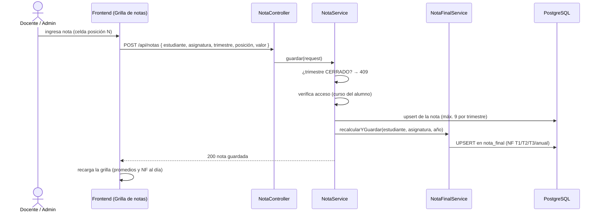

- La escritura de una nota dispara el **recálculo** de las cuatro notas finales y las
  persiste en `nota_final`. Lo mismo al **eliminar** una nota.
- El acceso se verifica contra el curso del alumno (un docente solo opera sus asignaturas).

### 15.4 Cálculo de notas finales

`CalculoNotasService` concentra las reglas. `NotaFinalService` las persiste.

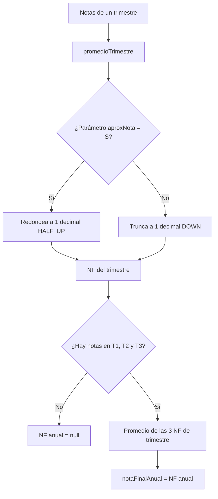

Las **cuatro notas finales** por estudiante y asignatura:

| Campo | Definición |
|---|---|
| NF T1 | Promedio de las notas del trimestre 1 |
| NF T2 | Promedio de las notas del trimestre 2 |
| NF T3 | Promedio de las notas del trimestre 3 |
| NF anual | Promedio de NF T1, T2 y T3. **Solo** si los tres trimestres tienen notas; si no, null |

**Regla de aproximación** (parámetro `aproxNota`): con `S` redondea el segundo decimal
hacia arriba (6.35 → 6.4); en otro caso trunca (6.35 → 6.3). Todas las notas finales se
muestran a 1 decimal.

> Estas cuatro notas se muestran en la grilla de notas y en el consolidado anual. El cálculo
> siempre lo hace el backend; el frontend solo muestra los valores.

### 15.5 Promoción de año

Proceso en dos fases (previsualizar y confirmar). **Requisito:** los tres trimestres del año
de origen deben existir y estar **todos cerrados**; de lo contrario, 422.

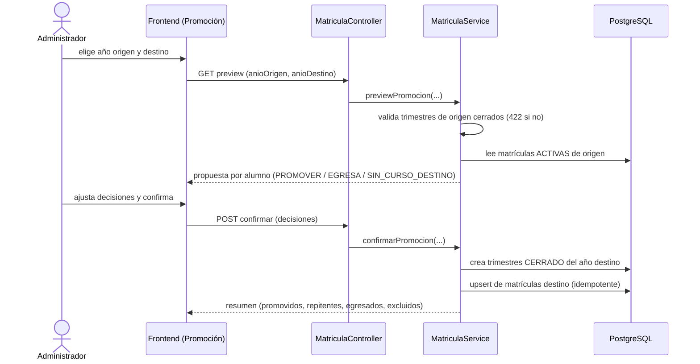

**Acciones de promoción** (enum `AccionPromocion`): `PROMOVER` (sube de nivel), `REPITENTE`
(mismo curso), `EGRESA` (último nivel), `EXCLUIR` (no se procesa). La previsualización
propone, el administrador ajusta y la confirmación escribe en una sola transacción.

**Separación por año escolar.** Cada año tiene sus propias matrículas, notas y trimestres.
Un estudiante que avanza de nivel mantiene su historial del año anterior intacto; las notas
del año nuevo parten en blanco. Así se distingue un año escolar de otro.

### 15.6 Endpoints del módulo académico

| Método | Ruta | Acceso | Descripción |
|---|---|---|---|
| GET | `/api/notas/grilla` | ADMIN/DOCENTE | Grilla de notas del curso+asignatura+trimestre |
| POST | `/api/notas` | ADMIN/DOCENTE | Graba/actualiza una nota |
| DELETE | `/api/notas/{id}` | ADMIN/DOCENTE | Elimina una nota |
| GET | `/api/notas/consolidado` | ADMIN/DOCENTE | Consolidado anual (NF T1/T2/T3/anual) |
| GET | `/api/notas/mis-asignaciones` | DOCENTE | Cursos y asignaturas del docente |
| GET | `/api/trimestres` | ADMIN/DOCENTE | Trimestres del año |
| POST | `/api/trimestres/anio/{anio}` | ADMIN | Crea los 3 trimestres (CERRADO) |
| PUT | `/api/trimestres/{id}/abrir` | ADMIN | Abre uno (cierra el resto) |
| PUT | `/api/trimestres/{id}/cerrar` | ADMIN | Cierra un trimestre |
| GET | `/api/matriculas/promocion/preview` | ADMIN | Previsualiza la promoción |
| POST | `/api/matriculas/promocion/confirmar` | ADMIN | Aplica la promoción |

### 15.7 Servicios del módulo académico

| Servicio | Responsabilidad |
|---|---|
| `NotaService` | Grilla, grabar/eliminar notas; dispara el recálculo de notas finales |
| `CalculoNotasService` | Reglas de promedio trimestral y nota final anual (aproximación) |
| `NotaFinalService` | Persiste y actualiza (UPSERT) las cuatro notas finales en `nota_final` |
| `TrimestreService` | Crear/abrir/cerrar trimestres; invariante de uno abierto |
| `MatriculaService` | Previsualización y confirmación de la promoción de año |
| `AnioEscolarService` | Resuelve y valida el año escolar activo |
